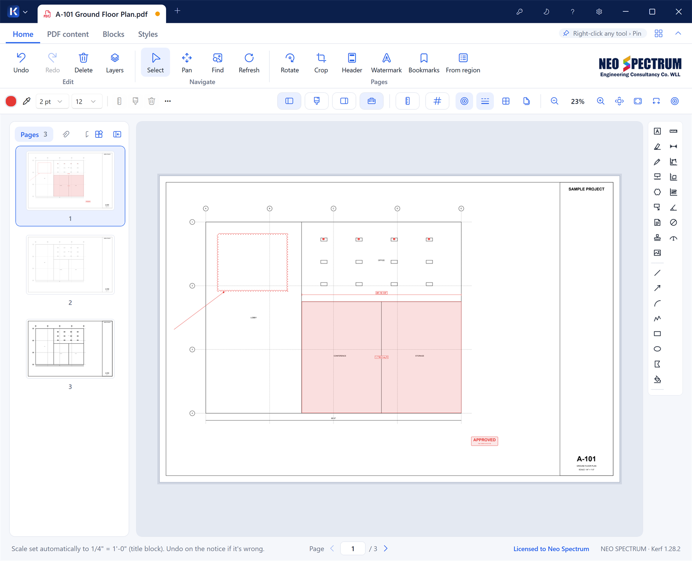
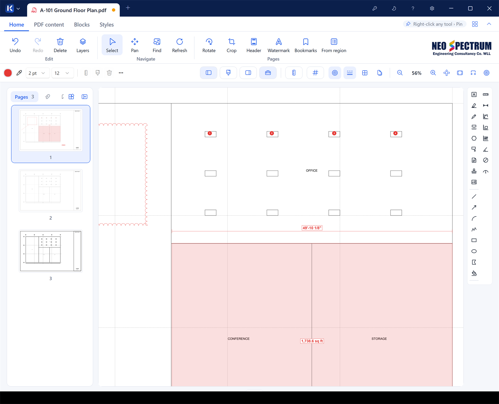
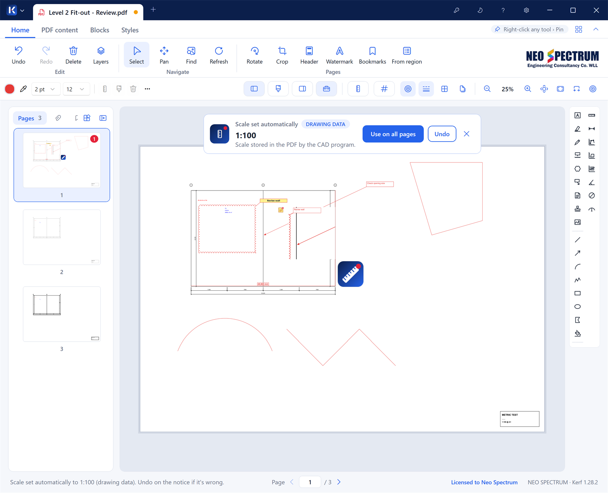

# Kerf

**PDF markup, measurement and takeoff for construction drawings.**

Mark up, measure and review drawing sets on Windows, to scale.

## What Kerf is for

Kerf is made for engineers, architects, quantity surveyors and site teams who live in PDF drawings. Open a drawing set and you can:

- **Review**: cloud, comment and stamp a drawing, then send it back with every note in the PDF.
- **Take off quantities**: measure lengths, perimeters and areas, and count items, all to the drawing's scale.
- **Coordinate**: bring in markups from Acrobat, Bluebeam or Foxit, filter them, reply to them and track their status.
- **Report**: export markups to Excel (CSV), print a review summary, or save a flattened PDF.

## Measure to scale, without the setup

- **Length, perimeter, area, count, angle and arc** tools. Double-click a drawing line to measure all of it in one go.
- **Snap to the drawing.** Points lock onto real lines and corners in the PDF.
- **Any units.** Show mm, cm, m, in, ft or ft-in, and m², ft², yd² or ha, with the decimals you want. Changing units never changes the drawing.
- **Imperial and metric preset scales**, or calibrate from any dimension on the sheet.

## The scale sets itself

When you open a drawing, Kerf tries to find its scale on its own. It reads the scale the CAD program saved in the PDF, the scale note in the title block, or three or more dimensions that agree. It allows for A1 sheets printed on A3. A notice tells you which scale it set and where it came from. One click applies the scale to every page, and one click undoes it.

> **Always check the scale and your measurements before you rely on them.** Kerf is a tool to help you work; the results are your responsibility.

## Features

| | |
|---|---|
| **Markup tools** | Text box, callout, cloud and Cloud+, highlight, pen, stamp, sticky note, image, line, arrow, arc, polyline, rectangle, ellipse, polygon, fill. |
| **Markups list** | Search and filter by type, status, author, layer and page. Click a row to jump to the markup. |
| **Comments** | Reply threads on every markup, with names, initials and times. They export as real PDF comments. |
| **Layers** | Group markups on layers, and show, hide or lock each one. |
| **Markups from other apps** | Markups made in Acrobat, Bluebeam, Foxit or Edge open as editable markups, with their authors, replies, statuses and measurements. |
| **Blocks library** | Keep your symbols (doors, WCs, logos, details) in one library. Import them from pictures or DWG/DXF and place them at real size. Share them as one file. |
| **Styles** | Save the look of any markup and reuse it. Share styles with your team. |
| **PDF editing** | Erase, cut, snapshot, white-out and redact PDF content. Edit text, crop and rotate pages, and add headers, footers and watermarks. |
| **Pages** | Thumbnails and a page grid. Reorder, insert, extract, duplicate, combine and rotate pages, by any angle. |
| **Bookmarks** | Read, edit and create bookmarks, or build them automatically from each sheet's number and title. |
| **Table to Excel** | Turn a table in a PDF, such as a schedule or a bill of quantities, into an Excel workbook. |
| **Tabs** | Open several drawings at once. Each tab keeps its own view, markups and undo history. |
| **Password-protected PDFs** | Open them, mark them up, and save them locked again. |
| **Explorer thumbnails** | See PDF previews right in Windows File Explorer. |

Markups are saved **inside the PDF** as standard PDF annotations, so other PDF viewers can show them too.

## Built for big drawing sets

Kerf draws pages with the PDFium engine at full screen resolution. It renders only what is visible and prepares the next pages in advance, so large CAD sheets stay responsive.

## Install

1. **[Download the latest Kerf-Setup.exe](https://github.com/8reb/kerf-releases/releases/latest)**. It's under **Assets** on the release page.
2. Run it. Everything Kerf needs is included, so nothing else has to be installed.
3. Open a PDF with **Ctrl+O**, drag one onto the window, or right-click a PDF and choose **Open with › Kerf**.

The installer isn't code-signed yet, so Windows SmartScreen may warn about it. Download Kerf only from this page. If the warning appears, click **More info** and check that the file is `Kerf-Setup-<version>.exe` from this page before choosing **Run anyway**.

**Requirements:** Windows 10 (1809 or later) or Windows 11, 64-bit.

## Updates

Kerf checks for new versions when it starts. When one is out, it offers to download and install it for you. Your settings, licence, blocks and styles are kept.

You can also download any version yourself from the [releases page](https://github.com/8reb/kerf-releases/releases).

## Licence

Kerf runs with **every feature for 14 days**. After the trial, it still opens and shows drawings. Marking up and measuring then need a licence key, which you enter in Kerf under **Licence** (the key icon in the title bar).

## Getting started

- Press **F1** in Kerf for the keyboard shortcuts.
- Click **?** in the title bar to replay the welcome tour.
- Right-click any tool and choose **Pin** to keep it on the quick bar.

---

Kerf is made by NEO SPECTRUM Engineering Consultancy Co. WLL.

